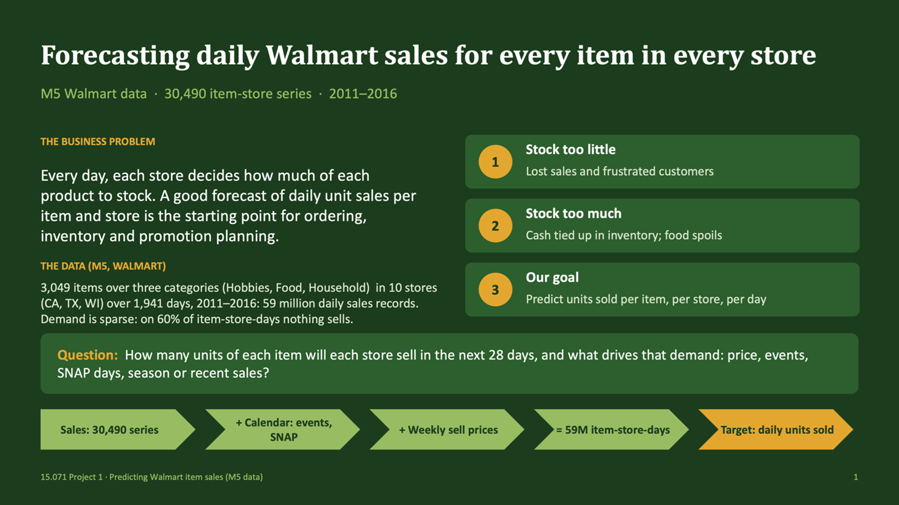

# M5 Walmart Sales Forecasting

**15.071 Project 1 · Predictive AI · November 20, 2026**



Forecast the next 28 days of unit sales for each item in each store to support replenishment planning. The current benchmark covers **30,490 item–store series**, **10 Walmart stores**, and **388 held-out days**.

[Download the M5 data ZIP](https://github.com/KimChen001/m5-walmart-sales-forecasting/releases/download/m5-data-v1/m5-forecasting-accuracy.zip) · [Run locally](#run-locally) · [Reproduce the full benchmark](#reproduce-the-full-benchmark) · [Results](#results) · [Reproduce TimesFM](#reproduce-timesfm-30)

The project evaluates **TimesFM 3.0, XGBoost, OLS, and an LSTM neural network** against simple forecasting baselines. The XGBoost benchmark below uses seasonal naive and a 28-day moving average. Other experiments use their documented forecast horizons and scoring panels.

## Run locally

Clone the repository and download `m5-forecasting-accuracy.zip` from the link above. In PowerShell, replace the ZIP path if your browser saved it elsewhere.

```powershell
git clone https://github.com/KimChen001/m5-walmart-sales-forecasting.git
cd m5-walmart-sales-forecasting
Expand-Archive -LiteralPath "$env:USERPROFILE\Downloads\m5-forecasting-accuracy.zip" -DestinationPath .
python -m pip install "xgboost==3.4.1" "pandas==3.0.6" "numpy==2.5.3" "scikit-learn==1.9.1"
python xgb_forecast.py --state CA --cat FOODS --device cpu --quick
Import-Csv outputs/xgb_CA_FOODS_quick/metrics_overall.csv | Format-Table R2,MAE,WAPE,WRMSSE
```

Run the clone and download steps with a GitHub account that has access to this private repository. The quick run checks the training and scoring pipeline on **5,748 California FOODS series** with a reduced tree budget. It completed in approximately **3 minutes** on the development machine. The scripts read `calendar.csv`, `sales_train_evaluation.csv`, and `sell_prices.csv` from the repository root. The [official Kaggle data page](https://www.kaggle.com/competitions/m5-forecasting-accuracy/data) documents the files.

## Results

| Full panel, 28-day forecasts | R² ↑ | MAE (units) ↓ | WAPE ↓ | M5 WRMSSE (12 levels) ↓ |
|---|---:|---:|---:|---:|
| Seasonal naive, lag 28 | 0.3057 | 1.2308 | 93.98% | 0.9378 |
| 28-day moving average | 0.5782 | 1.0204 | 77.91% | 1.0655 |
| XGBoost M1 · Calendar and IDs | 0.5257 | 1.1119 | 84.89% | 0.9384 |
| XGBoost M2 · Adds price, SNAP and events | 0.5332 | 1.0968 | 83.75% | 0.9938 |
| **XGBoost M3 · Adds sales history** | 0.6289 | 0.9790 | 74.75% | **0.6812** |
| **TimesFM 3.0 · Fitted decile weights** | **0.6376** | **0.9669** | **73.83%** | 0.8248 |

MIT ORCD jobs `29323394` (XGBoost) and `28701113` (TimesFM). Relative to seasonal naive, M3 reduced MAE by **0.252 units per scored item–store–day** and WRMSSE by **27.4%**. A replenishment simulation with lead times, holding costs and stockout costs is needed to estimate the business impact.

## Reproduce the full benchmark

On MIT ORCD, place the three CSVs next to `xgb_forecast.py` and submit the batch job from the repository root.

```bash
bash cluster/setup_env.sh  # first run only
mkdir -p logs
sbatch cluster/run_xgb_both.sbatch
```

The [training script](xgb_forecast.py) fits XGBoost regressors with Tweedie loss. It trains on days 1–1,553 and tests on days 1,554–1,941. Early stopping uses the final 90 training days before refitting. The 28-day backtest uses 14 rolling windows and scores 24 days in the last window. The next-day experiment updates sales history daily and writes to its own output directory.

| Output | Location |
|---|---|
| 28-day forecasts | `outputs/xgb_ALL_ALL/` |
| Next-day forecasts | `outputs/xgb_ALL_ALL_h1/` |
| Full-panel scores | `metrics_overall.csv` in either directory |
| Regular-seller scores | `metrics_final_regular50.csv` in either directory |

R², MAE, and WAPE are computed per item–store–day. [WRMSSE scoring](wrmsse.py) uses trailing 28-day dollar-sales weights across all 12 levels. In the CSV, `WRMSSE` is the 12-level score and `WRMSSE_L12` is the item–store score.

## Reproduce TimesFM 3.0

[TimesFM 3.0 evaluation script](timesfm3_improvements.py) uses the same three M5 CSVs, 30,490 series, and chronological 80/20 split as the XGBoost benchmark. It holds the pretrained model weights fixed, adds price, event and historical zero-run features, and fits nine nonnegative decile weights on four windows before the test period. The job compares median forecasts with symmetry off and on, equal decile weights, and fitted decile weights.

On MIT ORCD, start from the existing `m5` environment with CUDA-enabled PyTorch and SciPy. Install the TimesFM version used for the original run into a separate directory to keep its imports isolated.

```bash
module load miniforge
conda run -n m5 python -m pip install --no-deps --target timesfm3_lib 'timesfm==3.0.2'
mkdir -p logs
sbatch cluster/run_timesfm3_gpu.sbatch
```

The job first checks 16 series and then runs the full backtest, downloading the [Google checkpoint](https://huggingface.co/google/timesfm-3.0-pytorch) if needed. Outputs are under `outputs/timesfm3_<job_id>/full/`. Read `metrics_overall.csv` for the four configurations, `wrmsse_by_window.csv` for the 14 window scores, and `decile_weights.csv` for the fitted weights. Job `28701113` completed in 4 h 15 min on one GPU.

Both models report rolling WRMSSE across 12 M5 hierarchy levels. XGBoost zero-fills positions outside its scored rows when constructing the WRMSSE panel. TimesFM scores its complete forecast panel, so the WRMSSE comparison retains that implementation difference.

**Team contributions** · XGBoost by Zhixin. TimesFM 3.0 by Kayla, Zhixin, and Marco. Upcoming code contributions include OLS by Kayla and the neural network by Marco.
