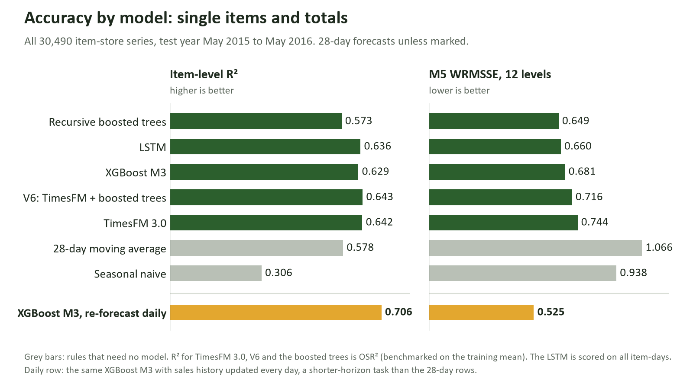
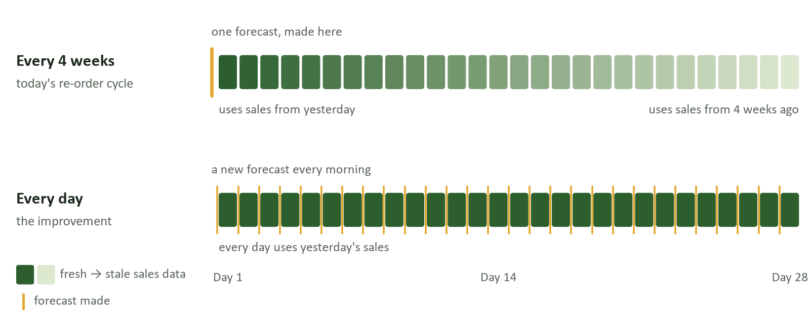
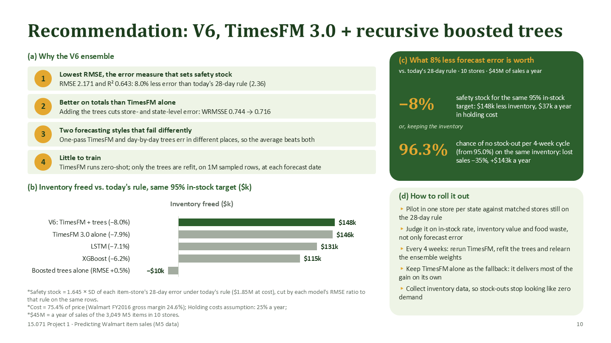

# M5 Walmart Sales Forecasting

**15.071 Project 1 · Predictive AI · November 20, 2026**

We forecast daily unit sales for every item in every store, 30,490 series across 10 Walmart stores, and translate forecast accuracy into inventory dollars. The best model frees about $148k of safety stock, and re-forecasting daily instead of every 4 weeks improves accuracy more than any choice between models.

## Contents

1. [The business problem](#the-business-problem): the decision the forecast supports
2. [Our approach](#our-approach): the prediction task and the models
3. [What we found](#what-we-found): accuracy across models
4. [The improvement: re-forecast daily](#the-improvement-re-forecast-daily): same model, fresher data
5. [Business impact](#business-impact): what the accuracy is worth
6. [Recommendation](#recommendation): what to do next
7. [Go deeper](#go-deeper): full results, code and how to reproduce

## The business problem

Every day, each store decides how much of each item to stock. Too little loses sales and frustrates customers; too much ties up cash and lets food spoil. We take a 28-day moving average, revised every 4 weeks, as the stores' current rule. A more accurate forecast of daily unit sales per item and store lets them hold less safety stock for the same in-stock rate.

## Our approach

**The prediction task.** Forecast the units sold of every item in every store for each of the next 28 days, re-forecasting every 4 weeks to match the re-order cycle. Inputs are past sales, weekly prices, calendar events and SNAP days. Every model trains on the first 80% of days and is scored on the last 20%, about 13 months from the end of April 2015 that no model sees during training.

| Model | How it works | Code |
|---|---|---|
| Seasonal naive, 28-day moving average | Rules a store can run today without a model | — |
| OLS, Ridge and LASSO | Regularised regression on next-day forecasts | [Notebook](notebooks/regression_ols_ridge_lasso.ipynb) |
| XGBoost | Gradient-boosted trees on calendar, price and recent sales; one model for all series | [Results notebook](notebooks/xgboost_full_panel.ipynb) · [script](xgb_forecast.py) |
| LSTM | One neural network for all series, reading 112 days of history | [Notebook](notebooks/lstm_d1553.ipynb) |
| TimesFM 3.0 | Google's pretrained forecasting model, used zero-shot, one series at a time | [Notebook](notebooks/timesfm3_v3_v6.ipynb) |
| V6 ensemble | Averages TimesFM 3.0 with recursive boosted trees | [Notebook](notebooks/timesfm3_v3_v6.ipynb) |

Accuracy is measured four ways: R², MAE and WAPE on each item–store–day, and the M5 WRMSSE, which also scores sales added up to stores, departments and states (12 levels).

## What we found

1. **Recent sales drive accuracy.** Adding lagged sales to XGBoost cut WRMSSE from 0.994 to 0.681; price, SNAP and events added little on their own.
2. **Past that, complexity buys little.** XGBoost, the LSTM, TimesFM 3.0 and V6 all reach R² 0.63 to 0.64. TimesFM 3.0 has the highest R² of the single models, while the models that learn across series are better on store and state totals (WRMSSE 0.649 for recursive boosted trees, 0.660 for the LSTM and 0.681 for XGBoost, against 0.744 for TimesFM 3.0).
3. **How TimesFM's output is read matters more than tuning the model.** Its raw outputs under-report right-skewed sales; reading them as a calibrated mean cut the total-sales bias from −7.0% to −0.8% and WRMSSE from 0.830 to 0.744.

## The improvement: re-forecast daily

Today's cycle forecasts 28 days at once, so by the fourth week the forecast is working from sales that are four weeks old. Re-forecasting every morning lets each day's forecast see yesterday's sales. We tested this with XGBoost M3, changing only the schedule: same model, same features, no retraining.

| XGBoost M3, full panel | R² ↑ | MAE (units) ↓ | WAPE ↓ | M5 WRMSSE (12 levels) ↓ |
|---|---:|---:|---:|---:|
| Re-forecast every 4 weeks | 0.6289 | 0.9790 | 74.75% | 0.6812 |
| **Re-forecast every day** | **0.7058** | **0.9108** | **69.54%** | **0.5249** |

The R² gain is more than five times the spread between XGBoost, the LSTM, TimesFM 3.0 and V6 (0.629 to 0.643), and these are the highest R² and lowest WRMSSE of any run on the full panel. WRMSSE falls most for totals: by 41% for total chain sales and by 7% for single item–store series. The gain applies to decisions made a day ahead; orders placed further ahead would gain less.

## Business impact

V6 forecasts with 8.0% less error than today's 28-day rule (RMSE 2.171 against 2.36). Safety stock scales with forecast error, so for the 10 stores and roughly $45M of annual sales in the data:

| Model | Forecast error vs today's rule | Inventory freed at the same 95% in-stock target |
|---|---:|---:|
| **V6: TimesFM 3.0 + boosted trees** | **−8.0%** | **$148k** |
| TimesFM 3.0 alone | −7.9% | $146k |
| LSTM | −7.1% | $131k |
| XGBoost M3 | −6.2% | $115k |
| Boosted trees alone | +0.5% | −$10k |

Holding that $148k of inventory costs about $37k a year. Alternatively, keeping inventory unchanged raises the chance of no stock-out in a 4-week cycle from 95.0% to 96.3%, cutting lost sales by about 35%, or about $143k a year. XGBoost M3 needs no GPU: it trains on CPU, and both of its schedules ran in 3 h 15 min on 32 ORCD cores. TimesFM 3.0 and V6 need a GPU.

Assumptions

Safety stock is 1.645 × the standard deviation of each item-store's 28-day forecast error under today's rule ($1.85M at cost), scaled by each model's RMSE relative to that rule on the same rows. RMSE is used here because safety stock depends on the spread of forecast errors. Cost is 75.4% of price (Walmart FY2016 gross margin 24.6%), and holding cost is 25% a year.

## Recommendation

- **Adopt V6 for replenishment forecasts**, starting with a pilot in one store per state against matched stores that stay on the 28-day rule. Judge it on in-stock rate, inventory value and food waste, not on forecast error alone.
- **Refresh the models every 4 weeks**: rerun TimesFM, refit the trees and relearn the ensemble weights. Keep TimesFM alone as the fallback, since it delivers most of the gain by itself.
- **Move to daily re-forecasting next.** It cut XGBoost's WRMSSE by 23% with no new model. Where no GPU is available, XGBoost M3 is the CPU option, with 6.2% less error than today's rule.
- **Collect inventory data**, so that stock-outs stop looking like zero demand.

## Go deeper

| Page | What is in it |
|---|---|
| [Full results](docs/results.md) | Every model's four metrics on the full panel, the team's TimesFM 3.0 runs, and next-day forecasts |
| [XGBoost results notebook](notebooks/xgboost_full_panel.ipynb) | What each feature group adds, the 12 hierarchy levels, accuracy across the test year, daily totals, feature importance, and where forecasting is hard |
| [Code and notebooks](docs/code.md) | Which file holds each model, its forecast task and its run time |
| [Run and reproduce](docs/reproduce.md) | A 3-minute local check, and the ORCD jobs behind every result |
| [Archived ORCD outputs](results/README.md) | The metrics and logs each result comes from |

Data: [download the M5 data ZIP](https://github.com/KimChen001/m5-walmart-sales-forecasting/releases/download/m5-data-v1/m5-forecasting-accuracy.zip) ([Kaggle data page](https://www.kaggle.com/competitions/m5-forecasting-accuracy/data)).

**Team** · Regression notebook by Kayla. XGBoost by Zhixin. LSTM notebook by Marco. TimesFM 3.0 by Kayla, Zhixin and Marco.
