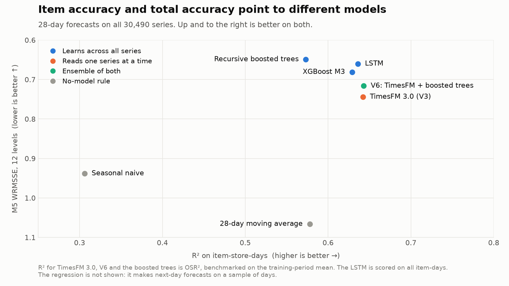

# M5 Walmart Sales Forecasting

**15.071 Project 1 · Predictive AI · November 20, 2026**


Forecast the next 28 days of unit sales for each item in each store to support replenishment planning. The current benchmark covers **30,490 item–store series**, **10 Walmart stores**, and **388 held-out days**.

[Summary and business impact](#summary) · [Download the M5 data ZIP](https://github.com/KimChen001/m5-walmart-sales-forecasting/releases/download/m5-data-v1/m5-forecasting-accuracy.zip) · [Run locally](#run-locally) · [Reproduce the full benchmark](#reproduce-the-full-benchmark) · [Results](#results) · [Reproduce TimesFM](#reproduce-timesfm-30)

The project evaluates **TimesFM 3.0, XGBoost, OLS, and an LSTM neural network** against simple forecasting baselines. The XGBoost benchmark below uses seasonal naive and a 28-day moving average. Other experiments use their documented forecast horizons and scoring panels.

## Summary

**The problem.** Every day, each store decides how much of each item to stock. Too little loses sales and frustrates customers; too much ties up cash and lets food spoil. A forecast of daily unit sales per item and store is the starting point for that decision.

**The prediction task.** Forecast the units sold of every item in every store (30,490 series) for each of the next 28 days, re-forecasting every 4 weeks to match the re-order cycle. Inputs are past sales, weekly prices, calendar events and SNAP days. Every model trains on the first 80% of days and is scored on the last 20%, about 13 months from the end of April 2015, which no model sees during training.

**Models compared.** Two rules a store can run today without a model (seasonal naive and a 28-day moving average); a regularised regression (OLS, Ridge and LASSO, on next-day forecasts); XGBoost, re-forecasting both every 4 weeks and daily; an LSTM; TimesFM 3.0 used zero-shot; and V6, which averages TimesFM 3.0 with recursive boosted trees.

**Key findings**

1. **Recent sales drive accuracy.** Adding lagged sales to XGBoost cut WRMSSE from 0.994 to 0.681; price, SNAP and events added little on their own.
2. **Past that, complexity buys little.** XGBoost, the LSTM, TimesFM 3.0 and V6 all reach R² 0.63 to 0.64. TimesFM 3.0 has the highest R² of the single models, while the models that learn across series are better on store and state totals (WRMSSE 0.649 for recursive boosted trees, 0.660 for the LSTM and 0.681 for XGBoost, against 0.744 for TimesFM 3.0).
3. **How TimesFM's output is read matters more than tuning the model.** Its raw outputs under-report right-skewed sales; reading them as a calibrated mean cut the total-sales bias from −7.0% to −0.8% and WRMSSE from 0.830 to 0.744.
4. **Re-forecasting daily is worth more than the choice of model.** On a next-day schedule XGBoost M3 reaches R² 0.706 and WRMSSE 0.525, against 0.629 and 0.681 when it re-forecasts every 4 weeks. That gain is larger than the gap between any two of the models above, and these are the highest R² and lowest WRMSSE of any run on the full panel. Next-day scores answer a shorter-horizon question, so they are not ranked against the 28-day models.



### Business impact

V6 forecasts with 8.0% less error than today's 28-day rule (RMSE 2.171 against 2.36). Safety stock scales with forecast error, so for the 10 stores and roughly $45M of annual sales in the data:

| Model | Forecast error vs today's rule | Inventory freed at the same 95% in-stock target |
|---|---:|---:|
| **V6: TimesFM 3.0 + boosted trees** | **−8.0%** | **$148k** |
| TimesFM 3.0 alone | −7.9% | $146k |
| LSTM | −7.1% | $131k |
| XGBoost M3 | −6.2% | $115k |
| Boosted trees alone | +0.5% | −$10k |

XGBoost M3 needs no GPU: it trains on CPU, and both of its schedules ran in 3 h 15 min on 32 ORCD cores. TimesFM 3.0 and V6 need a GPU.

Holding that $148k of inventory costs about $37k a year. Alternatively, keeping inventory unchanged raises the chance of no stock-out in a 4-week cycle from 95.0% to 96.3%, cutting lost sales by about 35%, or about $143k a year.

Assumptions: safety stock is 1.645 × the standard deviation of each item-store's 28-day forecast error under today's rule ($1.85M at cost), scaled by each model's RMSE relative to that rule on the same rows. RMSE is used here because safety stock depends on the spread of forecast errors. Cost is 75.4% of price (Walmart FY2016 gross margin 24.6%), and holding cost is 25% a year.

### Recommendation

Adopt V6 for replenishment forecasts, starting with a pilot in one store per state against matched stores that stay on the 28-day rule. Judge it on in-stock rate, inventory value and food waste, not on forecast error alone. Every 4 weeks, rerun TimesFM, refit the trees and relearn the ensemble weights, and keep TimesFM alone as the fallback, since it delivers most of the gain by itself. Collect inventory data, so that stock-outs stop looking like zero demand. Re-forecasting more often is a further lever, and XGBoost is the model we tested it with: moving it from a 28-day to a daily schedule cut its WRMSSE by 23% (see [Next-day forecasts](#next-day-forecasts)). Where no GPU is available, XGBoost M3 is the CPU option, with 6.2% less error than today's rule.


## Run locally

Clone the repository and download `m5-forecasting-accuracy.zip` from the link above. In PowerShell, replace the ZIP path if your browser saved it elsewhere.

```powershell
git clone https://github.com/KimChen001/m5-walmart-sales-forecasting.git
cd m5-walmart-sales-forecasting
Expand-Archive -LiteralPath "$env:USERPROFILE\Downloads\m5-forecasting-accuracy.zip" -DestinationPath .
python -m pip install "xgboost==3.4.1" "pandas==3.0.6" "numpy==2.5.3" "scikit-learn==1.9.1"
python xgb_forecast.py --state CA --cat FOODS --device cpu --quick
Import-Csv outputs/xgb_CA_FOODS_quick/metrics_overall.csv | Format-Table R2,MAE,WAPE,WRMSSE
```

The quick run checks the training and scoring pipeline on **5,748 California FOODS series** with a reduced tree budget. It completed in approximately **3 minutes** on the development machine. The scripts read `calendar.csv`, `sales_train_evaluation.csv`, and `sell_prices.csv` from the repository root. The [official Kaggle data page](https://www.kaggle.com/competitions/m5-forecasting-accuracy/data) documents the files.

## Results

[Browse original ORCD metrics, window scores, and run output](results/README.md).

| Full panel, 28-day forecasts | R² ↑ | MAE (units) ↓ | WAPE ↓ | M5 WRMSSE (12 levels) ↓ |
|---|---:|---:|---:|---:|
| Seasonal naive, lag 28 | 0.3057 | 1.2308 | 93.98% | 0.9378 |
| 28-day moving average | 0.5782 | 1.0204 | 77.91% | 1.0655 |
| XGBoost M1 · Calendar and IDs | 0.5257 | 1.1119 | 84.89% | 0.9384 |
| XGBoost M2 · Adds price, SNAP and events | 0.5332 | 1.0968 | 83.75% | 0.9938 |
| **XGBoost M3 · Adds sales history** | 0.6289 | 0.9790 | 74.75% | **0.6812** |
| TimesFM 3.0 · Sales-only baseline | 0.6121 | **0.8983** | **68.58%** | 1.6014 |
| **TimesFM 3.0 · Fitted decile weights** | **0.6376** | 0.9669 | 73.83% | 0.8248 |

Between the two main models, TimesFM leads on R², MAE and WAPE, which score each item–store–day on its own, while XGBoost M3 leads on the 12-level WRMSSE (0.681 against 0.825), which also scores sales summed to stores, departments and states. The sales-only TimesFM run has the lowest MAE and WAPE because it forecasts the median, which minimises absolute error, but it under-forecasts total sales by 26.7%. Fitting the decile weights on training data gives up some MAE to correct that level.

MIT ORCD jobs `29323394` (XGBoost), `27920694` (TimesFM baseline), and `28701113` (TimesFM adjusted). Relative to seasonal naive, M3 reduced MAE by **0.252 units per scored item–store–day** and WRMSSE by **27.4%**. [Business impact](#business-impact) translates these errors into inventory dollars.

### TimesFM in the presentation

The slide deck reports the team's TimesFM 3.0 notebook run (V3: stock-out cleaning, discount and major-event covariates, and a mean calibrated on earlier test windows) and the recommended V6 ensemble of V3 with recursive boosted trees. Both cover the same 30,490 series, with a test period that starts one day earlier (2015-04-30).

| Team notebook, 28-day forecasts | OSR² ↑ | MAE (units) ↓ | WAPE ↓ | M5 WRMSSE (12 levels) ↓ |
|---|---:|---:|---:|---:|
| TimesFM 3.0 · V3 | 0.6415 | 0.988 | 75.5% | 0.744 |
| **V6 · V3 plus recursive boosted trees** | **0.6425** | **0.984** | **75.2%** | **0.716** |

OSR² measures error against the training-period mean rather than the test-period mean. The notebook is [`notebooks/timesfm3_v3_v6.ipynb`](notebooks/timesfm3_v3_v6.ipynb).

### Next-day forecasts

The same job reran each model with sales history updated every day, which matches the setting of the regression experiment. Seasonal naive, M1 and M2 do not use recent sales, so their scores are unchanged and are omitted.

| Full panel, next-day forecasts | R² ↑ | MAE (units) ↓ | WAPE ↓ | M5 WRMSSE (12 levels) ↓ |
|---|---:|---:|---:|---:|
| Same as yesterday | 0.4666 | 1.1233 | 85.76% | 1.1184 |
| 28-day moving average | 0.6304 | 0.9757 | 74.50% | 1.0486 |
| **XGBoost M3 · Adds sales history** | **0.7058** | **0.9108** | **69.54%** | **0.5249** |

Moving M3 from a 28-day to a next-day schedule raises R² from 0.629 to 0.706 and lowers MAE from 0.979 to 0.911, WAPE from 74.75% to 69.54% and WRMSSE from 0.681 to 0.525.

## Reproduce the full benchmark

On MIT ORCD, place the three CSVs next to `xgb_forecast.py` and submit the batch job from the repository root.

```bash
bash cluster/setup_env.sh  # first run only
mkdir -p logs
sbatch cluster/run_xgb_both.sbatch
```

The [training script](xgb_forecast.py) fits XGBoost regressors with Tweedie loss. It trains on days 1–1,553 and tests on days 1,554–1,941. Early stopping uses the final 90 training days before refitting. The 28-day backtest uses 14 rolling windows and scores 24 days in the last window. Sales-history features (lags of 1 to 364 days and 7- to 180-day rolling means) are measured at each window's forecast origin, so every day in a window sees the same information, and a `days_ahead` feature tells the model how far ahead it is forecasting. The next-day experiment (`--horizon 1`) moves the origin to the previous day, updates sales history daily, and writes to its own output directory.

| Output | Location |
|---|---|
| 28-day forecasts | `outputs/xgb_ALL_ALL/` |
| Next-day forecasts | `outputs/xgb_ALL_ALL_h1/` |
| Full-panel scores | `metrics_overall.csv` in either directory |
| Regular-seller scores | `metrics_final_regular50.csv` in either directory |

R², MAE, and WAPE are computed per item–store–day. [WRMSSE scoring](wrmsse.py) uses trailing 28-day dollar-sales weights across all 12 levels. In the CSV, `WRMSSE` is the 12-level score and `WRMSSE_L12` is the item–store score.

## Reproduce TimesFM 3.0

The **sales-only baseline** (ORCD job `27920694`) used the same frozen TimesFM 3.0 checkpoint and 28-day backtest. It used sales history for prediction, kept symmetric averaging off, and took the default median forecast. Weekly prices identified which rows to score. WAPE and 12-level WRMSSE were calculated from the archived predictions. Baseline WRMSSE sets positions without saved forecasts to zero using the same scoring script as XGBoost.

After installing TimesFM below, run the [baseline script](timesfm_forecast.py) from the repository root on an ORCD GPU compute node:

```bash
module load miniforge
eval "$(conda shell.bash hook)"
conda activate m5
PYTHONPATH="$PWD/timesfm3_lib${PYTHONPATH:+:$PYTHONPATH}" python timesfm_forecast.py --model 3.0 --state ALL --cat ALL
```

Baseline outputs go to `outputs/timesfm3_ALL_ALL/`. The adjusted run uses the script and batch job below.

[TimesFM 3.0 evaluation script](timesfm3_improvements.py) uses the same three M5 CSVs, 30,490 series, and chronological 80/20 split as the XGBoost benchmark. It holds the pretrained model weights fixed, adds price, event and historical zero-run features, and fits nine nonnegative decile weights on four windows before the test period. The job compares median forecasts with symmetry off and on, equal decile weights, and fitted decile weights.

On MIT ORCD, start from the existing `m5` environment with CUDA-enabled PyTorch and SciPy. Install the TimesFM version used for the original run into a separate directory to keep its imports isolated.

```bash
module load miniforge
conda run -n m5 python -m pip install --no-deps --target timesfm3_lib 'timesfm==3.0.2'
mkdir -p logs
sbatch cluster/run_timesfm3_gpu.sbatch
```

The job first checks 16 series and then runs the full backtest, downloading the [Google checkpoint](https://huggingface.co/google/timesfm-3.0-pytorch) if needed. Outputs are under `outputs/timesfm3_<job_id>/full/`. Read `metrics_overall.csv` for the four configurations, `wrmsse_by_window.csv` for the 14 window scores, and `decile_weights.csv` for the fitted weights. Job `28701113` completed in 4 h 15 min on one GPU.

Both models report rolling WRMSSE across 12 M5 hierarchy levels. XGBoost zero-fills positions outside its scored rows when constructing the WRMSSE panel. The adjusted TimesFM run scores its complete forecast panel, so the WRMSSE comparison retains that implementation difference.

## Code by model

Every model in the presentation has its code here. The XGBoost script is at the repository root, the TimesFM 3.0 scripts are covered in [Reproduce TimesFM 3.0](#reproduce-timesfm-30), and the notebooks are in [`notebooks/`](notebooks). Open each notebook from that folder: it reads the three CSVs from the repository root.

| File | Model | Forecast task | Run notes |
|---|---|---|---|
| [`xgb_forecast.py`](xgb_forecast.py) | XGBoost M1–M3 and baselines on all 30,490 series; the source of the XGBoost results above | 28 days from each of 14 origins, and next day, training to `d_1553` | 3 h 15 min for both schedules on 32 ORCD cores (job `29323394`) |
| [`xgboost_ca_foods.ipynb`](notebooks/xgboost_ca_foods.ipynb) | XGBoost M1–M3 with feature importance, error by store, department, sales volume and month, and residual checks | 28 days ahead for California foods (5,748 series), training to `d_1553` | About 12 min on a CPU; also runs in Colab. It predates origin-anchored sales features (it lags them 28 days or more), so its scores differ from the full-panel results |
| [`exploratory_analysis.ipynb`](notebooks/exploratory_analysis.ipynb) | Data exploration behind the data slide | — | No model training |
| [`regression_ols_ridge_lasso.ipynb`](notebooks/regression_ols_ridge_lasso.ipynb) | OLS, Ridge and LASSO, λ by 10-fold cross-validation | Next day, on 80,000 training and 20,000 test item-store-days sampled at random | 35 min on 32 ORCD cores |
| [`lstm_d1553.ipynb`](notebooks/lstm_d1553.ipynb) | LSTM encoder–decoder, one network for all 30,490 series | 28 days from each of 14 origins, training to `d_1553` | About 5 min of training on one GPU; writes its test forecasts to `outputs/` |
| [`timesfm3_v3_v6.ipynb`](notebooks/timesfm3_v3_v6.ipynb) | TimesFM 3.0 V3, then V4 (with LASSO), V5 (fine-tuned output head) and V6 (ensemble with recursive boosted trees) | 28 days from each of 14 origins, training to `d_1552` | Imports `timesfm3`, installed as in the section above. Reads cached forecasts from `timesfm3_v3_forecasts_all/`, `timesfm3_v5_features_all/` and `timesfm3_v6_gbm_all/`; without them the TimesFM runs take several hours on a GPU |

**Team contributions** · XGBoost by Zhixin. TimesFM 3.0 by Kayla, Zhixin, and Marco. Regression notebook by Kayla and LSTM notebook by Marco.
